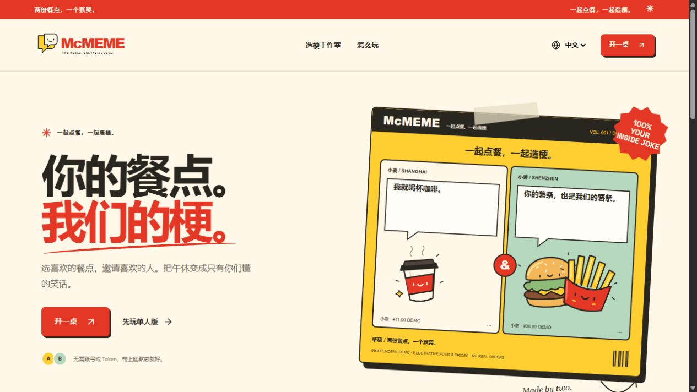
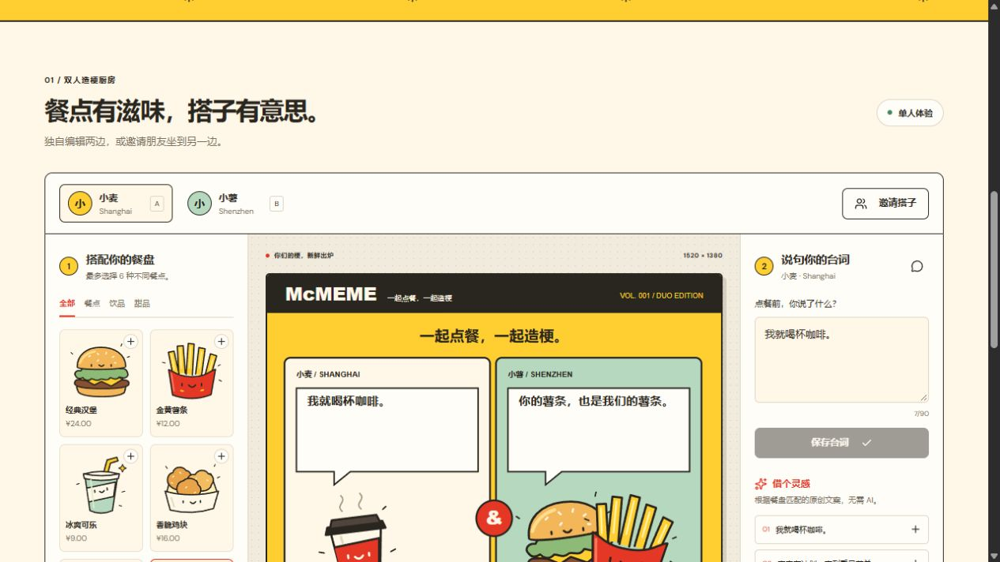
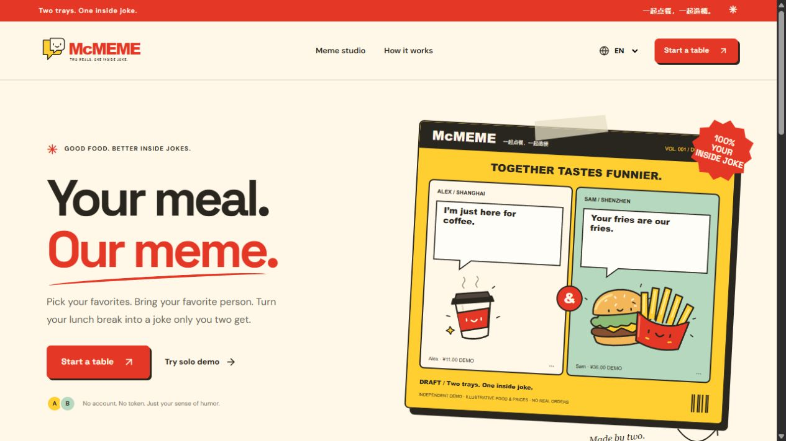
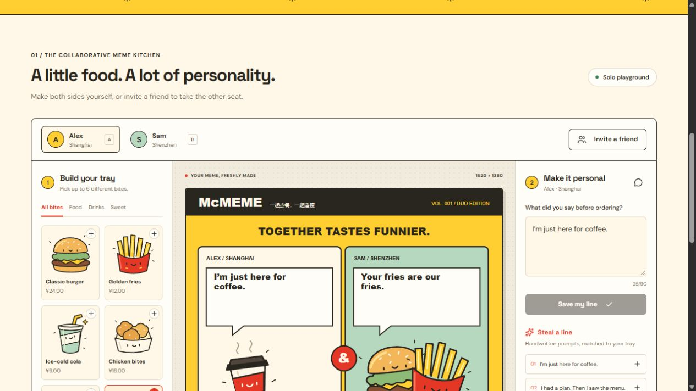
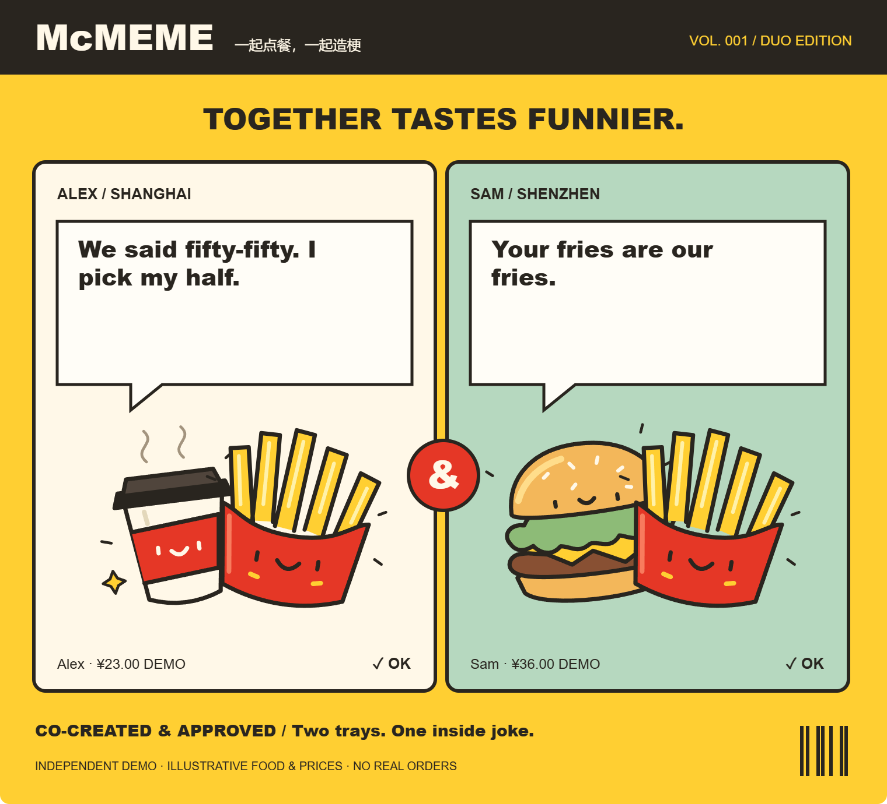

<p align="center"></p>

<h1 align="center">两份餐点，一个默契。</h1>
<p align="center"><strong>一起点餐，一起造梗。</strong></p>
<p align="center">简体中文 / 英文 · 双人协作 · 原创插画 · 高清 PNG 导出</p>



## 项目介绍

你说：“我就喝杯咖啡。”搭子说：“你的薯条，也是我们的薯条。”

McMEME 是一个双人餐点表情图工作室。各自选择餐点，写下自己的台词，把一次普通午休变成只有你们懂的小漫画。两个人一起创作、一起确认，再把这一刻带走。

适合朋友、情侣和同事：同桌吃饭可以玩，身处不同城市也可以共创。不需要绘画经验，选餐和聊天就是创作过程。

**当前状态：已实现基于演示数据的可运行原型；尚未接入真实麦当劳 MCP；已提交报名申请，等待主办方重新审核，不代表已通过资格审核。**

[在线预览（仅限所有者登录）](https://mcmeme-studio-vonnyluis.erceiha.chatgpt.site) · [MCP 接入说明](MCP_INTEGRATION.md) · [原创品牌素材](public/brand)

## 界面展示

以下为实际运行截图，餐点和价格均为演示数据。



<details><summary>查看英文界面与实际导出图片</summary>






</details>

## 体验流程

1. 打开应用，切换至「中文」，点击「先玩单人版」。
2. 给 A 座选一杯咖啡，给 B 座选汉堡和薯条。
3. 使用「借个灵感」中的文案，或写下自己的台词并保存。
4. 在「双人对话」「默契小票」「剧情反转」之间选择喜欢的版式。
5. 分别确认两边内容，下载高清 PNG。
6. 想与朋友一起玩？创建双人餐桌，将一次性邀请链接发给搭子。双方须能访问同一部署地址。

## 已实现功能

- **单人体验：** 自由编辑两个座位的餐盘和台词，尝试三种版式。
- **双人房间：** 独立座位凭证、轮询同步、D1 服务端持久化。
- **文案灵感：** 根据餐盘匹配原创规则库，无需大模型或 API 密钥。
- **共同确认：** 双方确认后才能导出；保存内容或更换版式会重置双方确认状态。
- **高清导出：** 生成 1520 × 1380 PNG，内嵌本地 SVG 插画。
- **双语与适配：** 简体中文和英文、响应式布局、弹窗键盘焦点管理、减少动态效果支持。

## 演示数据与真实接口的区别

当前六种餐点及价格均为自建演示数据。城市仅用于故事展示，不代表真实门店搜索结果。应用不会调用麦当劳实时服务，不会下单、支付或领取优惠券，也不声称提供实时库存。

已根据公开文档实现餐品响应格式转换，并使用文档示例测试。**格式兼容不等于真实 MCP 接入。** 接入范围与后续流程详见 [MCP_INTEGRATION.md](MCP_INTEGRATION.md)。

## 本地运行

需要 Node.js 22.13+ 和 npm。Windows 建议使用 Node.js 24+，以运行项目内直接读取 TypeScript 的测试。

1. 安装依赖：`npm run install:ci`
2. 构建项目：`npm run build`
3. 初始化本地数据库（每个本地数据库执行一次）：

```sh
node --import ./scripts/sites-env.mjs ./node_modules/wrangler/bin/wrangler.js d1 execute DB --local --config dist/server/wrangler.json --persist-to .wrangler/state --file drizzle/0000_careless_the_executioner.sql
```

4. 启动：`npm run dev`
5. 浏览器打开 http://127.0.0.1:5173

若 Windows 上的 npm 启动脚本解析异常，可使用 `node "C:/Program Files/nodejs/node_modules/npm/bin/npm-cli.js" run install:ci` 安装依赖，再直接运行 `node scripts/run-framework.mjs build` 或 `node scripts/run-framework.mjs dev`。

## 验证方式

```sh
node --test tests/core.test.mjs
node tests/rooms.integration.mjs
node node_modules/typescript/bin/tsc --noEmit
```

房间集成测试需要先启动本地服务并完成数据库初始化。测试覆盖金额转换、数据校验、两人加入与同步、一次性邀请、座位权限、版本冲突及确认状态重置。已人工检查 PNG 导出和移动端布局。

## 房间访问与数据说明

房间有效期为 7 天。访问凭证为随机令牌，服务端仅保存 SHA-256 摘要。邀请令牌放在链接片段中，只能使用一次。参与者只能修改自己的座位，双方均可更换版式；修改会重置确认状态。更新通过版本号检查避免相互覆盖。

凭证保存在 sessionStorage 中；恢复会话需使用原浏览器标签页。到期后禁止访问，但目前不自动物理删除数据库记录。

当前在线预览仅限所有者访问，房间邀请不会绕过网站访问权限。本地测试已验证两个独立参与者会话。面向公众开放前，还需加入请求限流、过期记录清理并检查访问策略。

## 视觉设计

品牌以漫画小刊物为灵感：番茄红、奶油黄、纸张底色、墨色描边和薄荷绿，搭配原创食物角色与对话气泡。

`public/brand` 包含原创 SVG 字标、气泡标志、六个食物角色和品牌海报。主色为 `#e53726`、`#ffcf32`、`#fff8e8`、`#29251f`、`#b6d8bf`。字体使用 Space Grotesk、DM Sans 及系统回退字体；外部字体不可用时，应用和图片导出仍可运行。

## 开源许可与声明

McMEME 原创代码与插画采用 [MIT 许可证](LICENSE)。第三方组件保留各自许可，详见 [第三方说明](THIRD_PARTY_NOTICES.md)。标准许可证原文保留英文。

本项目为独立创意原型，非麦当劳官方产品，与麦当劳无隶属或背书关系。相关商标属于各自权利人。

## 参赛资料

- [报名申请 #708](https://github.com/M-China/mcd-developer-innovation-challenge/issues/708)
- [官方参赛声明](CONTEST_DECLARATION.md)（按官方原文保留）
- [MCP 接入说明与当前状态](MCP_INTEGRATION.md)
- [脱敏配置示例](mcp-config.example.json)

已根据审核反馈补充声明文件；真实 MCP 接入尚未完成，参赛资格以主办方审核为准。
